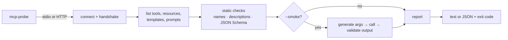

<div align="center">

# 🔬 mcp-probe

### Your MCP server starts. But does it actually work?

**List every tool, resource and prompt, validate every JSON schema and really call them, in one command.**

[](https://github.com/shadow-lo/mcp-probe/actions/workflows/ci.yml)


[Quick start](#-quick-start) · [What it catches](#-what-it-catches) · [Smoke calls](#-smoke-calls) · [Rules](#-rules) · [CI](#-use-it-in-ci)

</div>

---

An MCP server can boot, answer `initialize` and still be broken for the model that uses it. A typo in an
`inputSchema`. A `required` field that does not exist. A tool name with a space in it. Structured output that does
not match its `outputSchema`. A capability it advertises but never implemented.

Most clients quietly drop the tool or fail at call time, and you find out from a confused chat transcript.
**mcp-probe** connects like a real client, built on the official [`mcp`](https://pypi.org/project/mcp/) Python SDK,
and tells you exactly what is wrong before your users do.

<table>
<tr>
<td width="33%" valign="top">

### 🔌 Any server
stdio commands (`python`, `node`, `npx`, `uvx`, `docker`…) or Streamable HTTP URLs, with custom headers, env vars and working folder.

</td>
<td width="33%" valign="top">

### 🧪 Real calls
Generates valid arguments from each schema and calls tools, reads resources and renders prompts. Read-only tools by default.

</td>
<td width="33%" valign="top">

### 🤖 CI-ready
Meaningful exit codes, `--strict`, `--ignore`, and a `--format json` report for dashboards and bots.

</td>
</tr>
</table>

## 🚀 Quick start

```bash
pip install git+https://github.com/shadow-lo/mcp-probe

mcp-probe --smoke python examples/weather_server.py
```

```text
weather-demo 1.0.0  stdio · protocol 2026-07-28 · connected in 310 ms
  2 tools · 1 resource · 0 resource templates · 1 prompt

✓ tool get_forecast
✓ tool list_cities
✓ resource weather://cities
✓ prompt packing_list

Calls
  ✓ tool get_forecast {"city": "test"}  1 content block(s) (text), structured  5 ms
  ✓ tool list_cities {}  2 content block(s) (text), structured  4 ms
  ✓ resource weather://cities  1 content item(s)  4 ms
  ✓ prompt packing_list {"city": "test"}  1 message(s)  3 ms

4 calls made, 0 errors, 0 warnings
```

## 🐛 What it catches

[`examples/broken_server.py`](examples/broken_server.py) is a hand-written JSON-RPC server with the mistakes that
show up in real projects. Here is what mcp-probe says about it:

```text
$ mcp-probe --smoke python examples/broken_server.py
broken-demo 0.0.1  stdio · protocol 2025-06-18 · connected in 28 ms
  6 tools · 0 resources · 0 resource templates · 0 prompts

✗ server
     MP008  advertises prompts but listing them failed: Method not found: prompts/list
     MP009  tools/list result breaks protocol 2025-06-18 at tools.5.inputSchema.type: Input should be 'object'
✗ tool search docs
     MP002  inputSchema is not a valid JSON Schema: 'strng' is not valid under any of the given schemas (at properties.query.type)
     MP101  has no description, so a model has to guess what it does
     MP102  name 'search docs' has characters or a length the MCP spec does not allow
     MP104  input properties without a description: query
✗ tool add
     MP003  inputSchema root type must be "object", got 'array'
     MP004  tool name is listed more than once
     MP005  inputSchema requires 'c', which is not under 'properties'
     MP104  input properties without a description: a
✗ tool divide
     MP106  returned isError for {"a": 1, "b": 0}: division by zero
✗ tool crash
     MP006  call failed: Internal error: boom
✗ tool stats
     MP007  Invalid structured content returned by tool stats: 'many' is not of type 'integer'

Calls
  - tool search docs  skipped: not marked readOnlyHint (use --smoke-all)
  ✓ tool add {"a": 1, "b": 1, "c": "test"}  1 content block(s) (text)  1 ms
  ✗ tool divide {"a": 1, "b": 0}  isError: division by zero
  ✗ tool crash {}  Internal error: boom
  ✗ tool stats {}  Invalid structured content returned by tool stats: 'many' is not of type 'integer'
  - tool add  skipped: duplicate name, already called

4 calls made, 8 errors, 5 warnings
```

> [!TIP]
> When the SDK rejects a whole `tools/list` page because of one bad entry, mcp-probe re-reads the page raw,
> reports that entry (MP009) and keeps checking all the others instead of giving up.
>
> When a stdio server dies on startup, its last stderr lines are printed, so a missing API key is obvious.

## 🧭 How it works



## 📖 Usage

Options go **before** the server. Everything from the first non-option word on is the server command.

```bash
mcp-probe python server.py                         # launch a stdio server, list and check everything
mcp-probe "uv run my-server --verbose"             # a quoted command works too
mcp-probe --smoke npx -y @modelcontextprotocol/server-everything
mcp-probe https://example.com/mcp -H "Authorization: Bearer $TOKEN"
mcp-probe -e API_KEY=test --cwd ./server python -m my_server
mcp-probe --call 'add={"a": 1, "b": 2}' python server.py
mcp-probe --format json python server.py > report.json
mcp-probe --strict --ignore MP104,MP105 python server.py
mcp-probe --list-rules
```

| Option | Meaning |
|--------|---------|
| `--smoke` | call read-only tools, read resources, get prompts |
| `--smoke-all` | also call tools that are not marked destructive |
| `--call TOOL=JSON` | call one tool with your own arguments (repeatable) |
| `-H, --header 'K: V'` | HTTP header (repeatable) |
| `-e, --env K=V` / `--cwd DIR` | environment and working folder for a stdio server |
| `--timeout S` / `--slow MS` | per-request timeout (10 s) and slow-call warning threshold (2000 ms) |
| `-f, --format text\|json` | output format |
| `--strict` / `--ignore CODES` | fail on warnings / skip rules |

**Exit codes:** `0` clean or warnings only · `1` errors (or warnings with `--strict`) · `2` could not connect.

## 🧪 Smoke calls

Listing and schema checks never call anything. Calls happen only when you ask for them:

| Flag | What gets called |
|------|------------------|
| `--smoke` | tools annotated `readOnlyHint: true`, every resource (`resources/read`), every prompt (`prompts/get`) |
| `--smoke-all` | the same, plus every tool **not** annotated `destructiveHint: true` |
| `--call TOOL=JSON` | exactly that tool with those arguments, whatever its annotations |

Arguments come from each `inputSchema`: only the `required` fields, preferring `const`, `default`, `enum` and
`examples`, otherwise a minimal value that respects `format`, `minimum`/`maximum`, `minLength`/`maxLength`,
`minItems`, local `$ref`s and `anyOf`/`oneOf`. The arguments are validated against the schema before the call. If they
would not pass (a strict `pattern`, say), the tool is skipped and you can supply real ones with `--call`.

> [!WARNING]
> Tool annotations are hints a server sets about itself. Point `--smoke-all` at a test instance, not at production.

## 📋 Rules

| Code | Level | Checks |
|------|:-----:|--------|
| MP001 | 🔴 | the server starts and completes the MCP handshake |
| MP002 | 🔴 | every `inputSchema` / `outputSchema` is a valid JSON Schema (2020-12 unless `$schema` says otherwise) |
| MP003 | 🔴 | every `inputSchema` / `outputSchema` has root type `"object"` |
| MP004 | 🔴 | tool names, prompt names and resource URIs are unique |
| MP005 | 🔴 | every name in `required` is defined under `properties` |
| MP006 | 🔴 | smoke calls finish without a protocol error, crash or timeout |
| MP007 | 🔴 | `structuredContent` matches the tool's `outputSchema` |
| MP008 | 🔴 | an advertised capability (`tools`, `resources`, `prompts`) can actually be listed |
| MP009 | 🔴 | list results conform to the negotiated protocol version |
| MP101 | 🟡 | every tool has a description |
| MP102 | 🟡 | tool names use only `A-Z a-z 0-9 _ - .` and are 1-128 characters (MCP spec) |
| MP103 | 🟡 | tool names fit `^[a-zA-Z0-9_-]{1,64}$`, the pattern common LLM APIs accept |
| MP104 | 🟡 | every top-level input property has a description |
| MP105 | 🟡 | prompts, resources and resource templates have a description |
| MP106 | 🟡 | smoke calls do not come back with `isError: true` |
| MP107 | 🟡 | smoke calls answer faster than `--slow` |

🔴 error · 🟡 warning

## ⚙️ Use it in CI

```yaml
# .github/workflows/mcp.yml
name: Probe MCP server
on: [pull_request]
jobs:
  mcp-probe:
    runs-on: ubuntu-latest
    steps:
      - uses: actions/checkout@v4
      - uses: actions/setup-python@v5
        with:
          python-version: "3.13"
      - run: pip install git+https://github.com/shadow-lo/mcp-probe
      - run: mcp-probe --smoke --strict python server.py
```

Need the numbers somewhere else? `--format json` prints the server info, every listed item, every call with its
timing and every finding.

## 🛠️ Development

```bash
git clone https://github.com/shadow-lo/mcp-probe && cd mcp-probe
pip install -e ".[dev]"
pytest
```

The tests start real servers: [`examples/weather_server.py`](examples/weather_server.py), built with the SDK and run
over both stdio and Streamable HTTP, and [`examples/broken_server.py`](examples/broken_server.py), which has every
mistake above.

```text
src/mcp_probe/
├── cli.py      argument parsing, text and JSON output
├── probe.py    connect, list, smoke-call, collect findings
├── checks.py   the rules: names, descriptions, JSON Schema
└── sample.py   minimal valid arguments from a JSON Schema
```

## 📄 License

[MIT](LICENSE)
